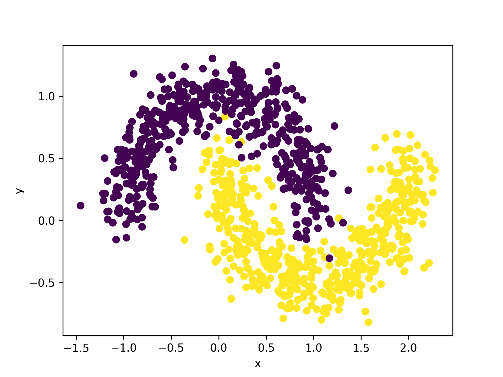
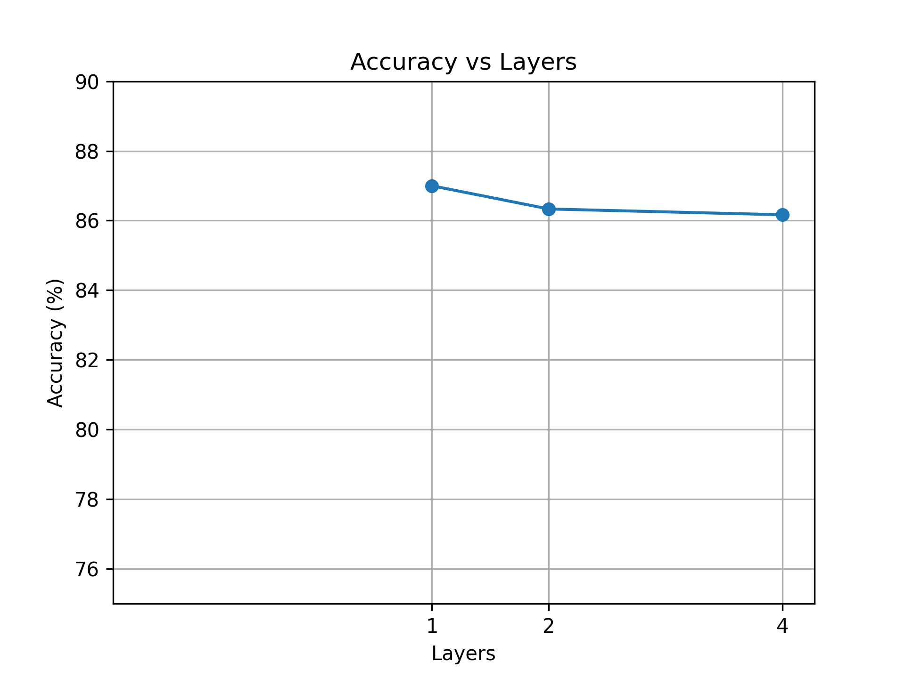

# Challenge 3

## Hipoteza

Chcę sprawdzić czy zwiększenie liczby warstw w obwodzie kwantowym rzeczywiście poprawia accuracy modelu.

Moim zdaniem zwiększenie liczby warstw w obwodzie kwantowym powinno poprawić accuracy klasyfikatora.

Spodziewam się że model z 4 warstwami osiągnie średnie accuracy wyższe niż model z 1 warstwą.

## Wyjaśnienie

Każda dodatkowa warstwa zawiera kolejne bramki i parametry które model może dopasować podczas treningu.

Wydaje mi się więc, że większa liczba warstw powinna pozwolić modelowi lepiej rozdzielać dane szczególnie kiedy klasy nie są oddzielone prostą linią, tak jak w make moons.

## Jak to zrobie?

Do sprawdzenia hipotezy wykorzystam zbiór make_moons mający 1000 sampli, z noise 0.15.

## Wyniki

Sprawdziłem trzy wersje modelu: z 1, 2 i 4 warstwami ansatzu.

Dla każdej liczby warstw uruchomiłem trening 3 razy używając różnych wartości seed: 3, 11 i 29.
Następnie policzyłem średnią accuracy na zbiorze testowym.



### Otrzymane wyniki
```
Training: 1 layers, seed 3
Accuracy: 86.50%
Training: 1 layers, seed 11
Accuracy: 87.50%
Training: 1 layers, seed 29
Accuracy: 87.00%
Mean accuracy: 87.00%
Training: 2 layers, seed 3
Accuracy: 85.50%
Training: 2 layers, seed 11
Accuracy: 87.50%
Training: 2 layers, seed 29
Accuracy: 86.00%
Mean accuracy: 86.33%
Training: 4 layers, seed 3
Accuracy: 85.50%
Training: 4 layers, seed 11
Accuracy: 86.50%
Training: 4 layers, seed 29
Accuracy: 86.50%
Mean accuracy: 86.17%
Improvement from 1 to 2 layers: -0.67 pp
Improvement from 2 to 4 layers: -0.17 pp
```



Moja hipoteza nie potwierdziła się.

Spodziewałem się że większa liczba warstw poprawi accuracy ale najlepszy wynik dał model z 1 warstwą. Dodanie kolejnych warstw nie poprawiło accuracy a nawet lekko ją obniżyło.

Możliwa przyczyna jest taka że większa liczba warstw daje więcej parametrów do dopasowania ale przy tym samym limicie iteracji optymalizatora model może mieć trudniej znaleźć dobre ustawienie. Możliwe też że dla danych make_moons już prostszy obwód jest wystarczający i większa głębokość nie daje wiekszych przewag.

## Zagwozdka

Co jesli zwiększyć liczbe iteracji optymalizatora? 

Zwiekszyłem iteracje z 120 do 500 po długim czekaniu otrzymałem następujące wyniki:

```
Training: 1 layers, seed 3
Accuracy: 86.50%
Training: 1 layers, seed 11
Accuracy: 87.00%
Training: 1 layers, seed 29
Accuracy: 87.00%
Mean accuracy: 86.83%
Training: 2 layers, seed 3
Accuracy: 86.50%
Training: 2 layers, seed 11
Accuracy: 87.50%
Training: 2 layers, seed 29
Accuracy: 86.50%
Mean accuracy: 86.83%
Training: 4 layers, seed 3
Accuracy: 86.50%
Training: 4 layers, seed 11
Accuracy: 87.00%
Training: 4 layers, seed 29
Accuracy: 87.00%
Mean accuracy: 86.83%
Improvement from 1 to 2 layers: 0.0 pp
Improvement from 2 to 4 layers: 0.0 pp
```
Tym razem wszystkie 3 modele otrzymały tę samą accuracy podejrzewam że dla tych danych jedna warstwa w zupełności wystarcza i nie ma sensu dodawać kolejnych warstw.
